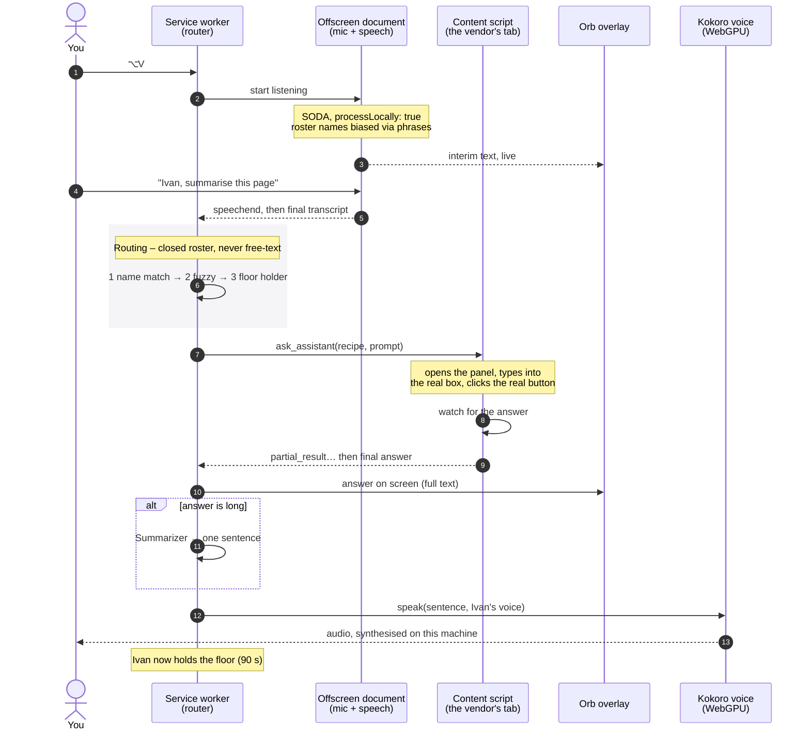
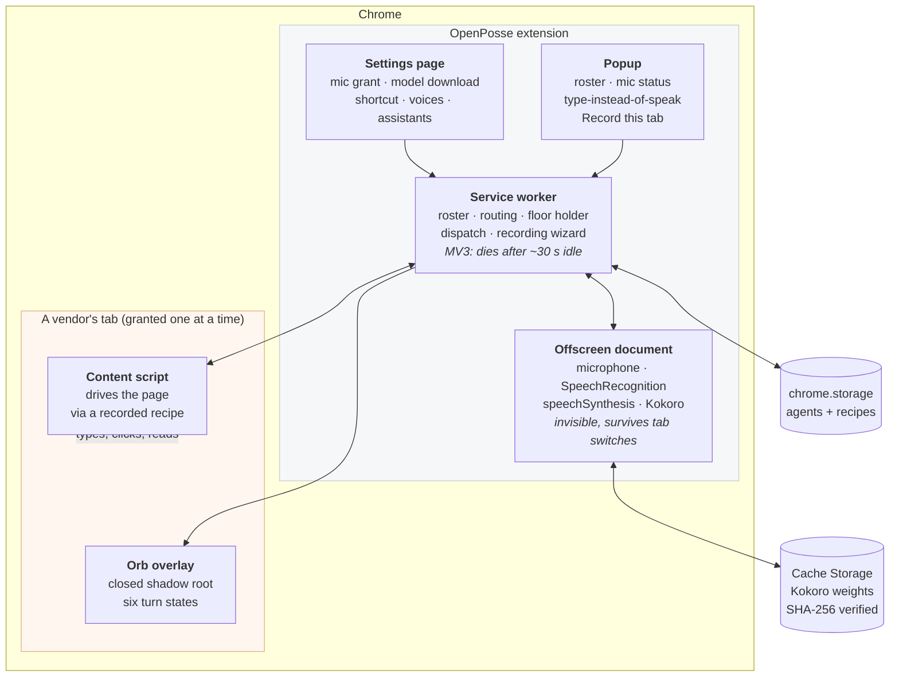
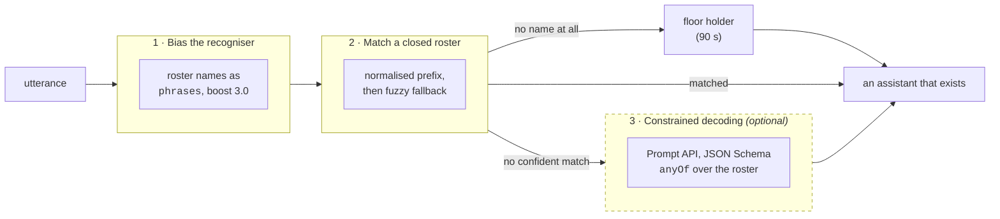
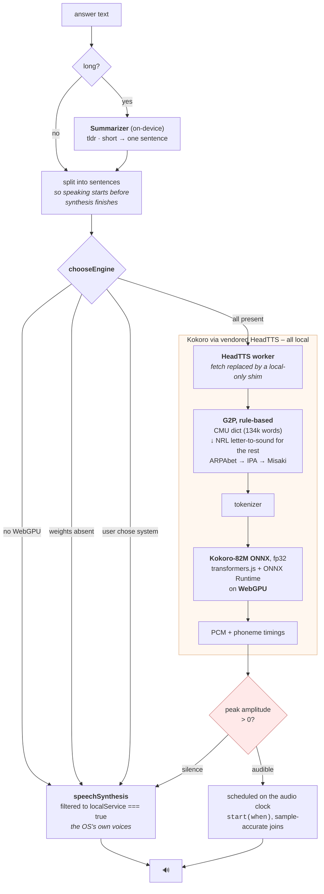
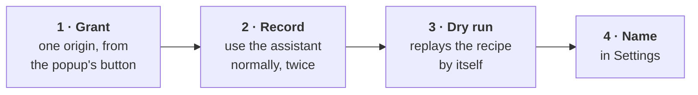

<div align="center">


**Talk to the AI assistants you already use.**
It listens, works out who you meant, and asks them – without anything leaving your machine.

[](LICENSE)


</div>

---

## What it is

You already have AI assistants. Notion has one. Your EA tool has one. Your helpdesk has one.
Each lives behind a different button, in a different tab, with a different text box.

OpenPosse gives each of them a **name** and lets you talk to them out loud.

> *"Ivan, summarise the Q3 planning page."*
>
> *"Andy, how many of our applications are end of life?"*
>
> *"...and what about next quarter?"* – no name needed; the last one to answer still holds the floor.

You press a shortcut, say a name and a request. OpenPosse routes the utterance to the right
assistant, types into the assistant's own box, presses its own send button, watches for the answer,
and reads it back to you in that assistant's voice.

**It acts.** That is the whole point. Dictation into a web field is a solved feature and a crowded
category; the market leader states plainly that it will not click Send for you. Clicking Send is
the half OpenPosse is built around.

### Three promises that shape every design decision

**Nothing leaves the device.** Speech recognition, routing and speech synthesis all run locally. A turn is a microphone, a page, and an answer, with nothing else in it. There is no
account, no API key and no server.

**No JSON, no terminal, no jargon.** Adding a new assistant is a four-step wizard where you show
OpenPosse how you use it. Nobody writes a selector.

**It only uses tabs you already have open.** OpenPosse drives the assistant in the tab you are
signed into, and "show me" switches to that same tab. It never opens a vendor's site for you: not
to ask a question, and not to show you an answer. A fresh tab would be the assistant with none of
your conversation in it, possibly not signed in at all. If no tab is open, OpenPosse says so and
stops. `test/tabs.test.mjs` fails if code outside the Settings page creates a tab or a
window.

---

## How a turn works, end to end



Nothing in that sequence touches the network. The one exception is the vendor's own page doing what
it always does: you are already logged into Notion, and Notion talks to Notion.

### It does not switch tabs, and that is deliberate

Driving the page happens through the DOM, not through synthetic keystrokes, so the tab does not need
focus. Measured with the tab unfocused, on another page of the same vendor, in a different window,
and in the vendor's chat view: all four work.

So an automatic tab switch buys nothing and costs a context switch. Navigation is something you
**ask for** instead:

| You say | What happens |
|---|---|
| `show me`, `open it`, `take me there` | Raises the floor holder's tab |
| `take me to Notion`, `switch to Notion` | Raises that assistant's tab, by product name |
| `yes` to "Would you like to see it?" | Raises the tab of the assistant that just answered |
| `show me the Q3 numbers` | **Stays a question.** Not navigation |

Every row switches to a tab that is already open, and the same one a question would be asked in.
None of them opens one: with no Notion tab open, "take me to Notion" answers "No Notion tab is
open."

A long answer is spoken as its first sentence and "The rest is on screen. Would you like to see
it?" On a spoken turn the microphone then opens once for the reply: yes goes to the tab, no closes
the offer, and silence lets it lapse. A typed question is not asked, because someone who typed may
not be able to talk.

That last row is the whole reason this needs care. An utterance is navigation only when the intent
phrase plus an optional vendor name consumes *the entire utterance*. Anything left over is a
question. A false positive here does not merely misfire – it eats the request and switches tabs
while the user watches their question vanish.

---

## Architecture

Five contexts, each picked for a constraint rather than for tidiness.



| Context | Job | Why there and not somewhere else |
|---|---|---|
| **Offscreen document** | mic, speech recognition, speech synthesis | Extension origin, so **one** microphone grant rather than one per site. Invisible, and survives tab switches. A service worker has no DOM and so no audio at all |
| **Service worker** | roster, routing, floor holder, dispatch, the recording wizard | The only thing that outlives any single page. It is terminated after ~30 s idle and **reconstructs its state from storage on every wake** |
| **Content script** | drives the vendor's page; hosts the orb | Only place with DOM access to someone else's app |
| **Popup** | roster, mic status, manual fallback, "Record this tab" | Owns the **user gesture** that `chrome.permissions.request()` needs |
| **Settings page** | one-time grants, model download, voices, assistants | The mic prompt needs a real tab. An offscreen document has nowhere to show it, and a side panel fails with `NotAllowedError` on macOS |

### Where state lives

- **`chrome.storage.local`** – the roster (`agents`) and one `recipe:<id>` per assistant.
- **`chrome.storage.session`** – the floor holder and its timestamp. Cleared when the browser closes.
- **Cache Storage** – Kokoro's weights, written once by setup after each file's SHA-256 is checked.

---

## Speech in

Chrome 139 shipped `processLocally` on the Web Speech API. Recognition runs on Google's **SODA**
model, on your machine.

```js
recognition.processLocally = true;   // a requirement, not a preference
recognition.interimResults = true;
recognition.phrases = roster.map(name => new SpeechRecognitionPhrase(name, 3.0));
```

Three things worth knowing:

**`processLocally` must be `true`.** The default is `false`, which lets Chrome choose, which can
mean Google's servers. Setting it true makes local a *requirement* – you get an `error` event with
`service-not-allowed` rather than a silent cloud fallback. That is the failure mode to want.

**The `phrases` boost is logarithmic.** It takes 0.0–10.0 and invites reading as "how keen are you,
out of ten". It is roughly the *natural log* of how many times likelier the phrase is than the model
thinks. An early version used 8, asserting "Ivan" was ~3,000× more likely than English says; the
recogniser duly produced interim text reading `Ivan Ivan Ivan…` thirty-three times. **3.0** (~20×)
is what the spec's own explainer uses for a proper noun. Biasing is for winning close calls –
"Ivan" over "even" – not for overruling the audio.

**Endpointing is free here.** The macOS app had to detect end-of-turn from the *absence* of
transcription, because Apple's `SpeechDetector` emits nothing. Web Speech ends the turn itself:
`speechend` fires, a final result follows ~76 ms later, and `end` closes it. No timer, no threshold
to tune.

---

## Routing

Three independent layers. Each is cheap; together they make a wrong assistant unlikely and an
*invalid* one impossible.



Layers 1 and 2 are the product. **Layer 3 is decoration** and must be treated as absent by default.
Chrome's Prompt API needs 22 GB free disk plus either >4 GB VRAM or 16 GB RAM – but on the
development machine the real blocker was something else entirely:

> The on-device model is not available because the enterprise policy disables the feature.

`availability()` returns plain `'unavailable'` for that, indistinguishable from a weak machine. This
is probably the *common* case for this product: OpenPosse is for people talking to Notion and their
EA tool **at work**, which is the same population whose browsers are centrally managed. So the copy
never tells a managed user their machine is not powerful enough – it is, and buying a better one
changes nothing.

**The floor holder** makes a name-less follow-up a first-class outcome rather than a failure. Whoever
last answered keeps the floor for 90 s.

---

## The voice, end to end

Long answers are shortened before they are spoken – Chrome's on-device `Summarizer` with
`type: 'tldr', length: 'short'` returns one sentence, while the full text stays on screen. Then the
sentence is synthesised.



### Why HeadTTS and not `kokoro-js`

The obvious package is disqualified by a licence rule this project applies to anything with a model
in it: **verify the dependency graph, not the badge.**

`kokoro-js` depends on `phonemizer@1.2.1`, which declares `Apache-2.0` while describing itself as *a
text to phones converter using eSpeak NG* – 2.7 MB unpacked, zero npm dependencies, and no NOTICE
anywhere. eSpeak NG is **GPL-3.0**. A package that size with no dependencies is shipping the engine
inside it.

[HeadTTS](https://github.com/met4citizen/HeadTTS) replaced the GPL front end rather than merely
claiming to. Verified by graph:

| Component | Licence |
|---|---|
| HeadTTS | MIT |
| CMU Pronouncing Dictionary (134k words) | simplified BSD |
| NRL Report 7948 letter-to-sound rules (1976) | US Navy report |
| transformers.js + ONNX Runtime | Apache-2.0 |
| Kokoro-82M-v1.0-ONNX-timestamped + voices | Apache-2.0 |

No eSpeak in that graph. HeadTTS is architected as a Node server and is not on npm, so only its
in-browser module is used, vendored from GitHub with four OpenPosse patches marked in-file.

### Three things about the weights that cost real time

**Do not switch the model to fp16.** The reasoning that leads there is correct – int8 graphs often
have no WebGPU kernels, so part of the graph runs on CPU, which is why `q8` measures ~1.6× real time.
fp16 fixes exactly that: 5.3 s of speech in 660 ms, **thirteen times faster**. Every sample was zero.
ONNX Runtime's WebGPU backend produces NaN for Kokoro at fp16 ([#29807](https://github.com/microsoft/onnxruntime/issues/29807),
[#26732](https://github.com/microsoft/onnxruntime/issues/26732)), and NaN reaches the WAV encoder as
zeros – so it plays for exactly the right number of milliseconds and cannot be heard.
**fp32 is the default**; `q8` is the fallback worth remembering.

**An unrecognised dtype is ignored, not rejected.** transformers.js silently falls back to its fp32
default, and two names break the `model_<dtype>.onnx` pattern anyway: fp32 is the unsuffixed
`model.onnx` and q8 is `model_quantized.onnx`. A test pins the dtype to its file, because nothing
downstream ever will.

**The voice checks its own output.** `kokoro.js` measures peak amplitude and refuses a buffer of
zeros, falling back to a system voice. Until that existed, "the model produced silence" and "the
audio was inaudible" were the same event – buffers played for the right duration and resolved
successfully while the room stayed quiet.

*Measured:* synthesis runs at 0.17–0.24× real time, and chunks are spoken as they arrive, so the
voice step costs ~1.15× the answer's own length against 2.58× before.

### The download

340.2 MB, once, **from setup, when you press the button** – never during a turn, never on first use.
Each file is checked against a SHA-256 baked into the build before anything uses it; a mismatch means
the file is discarded. A model is code in every sense that counts, and one that arrives unverified is
arbitrary code from a third party.

All **28 voices** ship. It was six, on a comment claiming the full set would cost 28.7 MB. It is
14.6 – every voice file is exactly 522,240 bytes – so the other 22 cost 11.5 MB against a 326 MB
model. The bytes were never the real cost of a subset: with part of the set on disk, *"which voices
exist"* and *"which are installed"* became different questions, and one caller got it wrong and
handed an assistant a voice file that was not there.

---

## Adding an assistant

No vendor appears in `manifest.json`. There is no static `content_scripts` entry and no
`host_permissions` – a hardcoded vendor is exactly what "add an assistant without writing code" means
to be rid of. **An assistant is a recorded recipe in storage, not code.**



The wizard watches you open the assistant, type a question, send it, and receive an answer – twice,
because two samples are what let it derive a selector describing *both* answers rather than one
message. The orb coaches you through it and ticks each capture off as it lands.

A finished recipe is inspectable from Settings ("See"):

| Field | Example |
|---|---|
| `site` | `notion.so` |
| `opens with` | `⌘ J` or a recorded selector |
| `message box` | `[data-testid="composer"] textarea` |
| `sends with` | `↩ Enter`, or a button selector |
| `answer appears` | a container selector |
| `knows when done` | the vendor's own "still generating" control |
| `quiet period` | `900 ms` |
| `gives up after` | `60 s` |

**The dry run is not the recording.** It executes the finished recipe twice, automatically, and is
the only place two things can be settled – whether a *synthetic* trigger opens the panel a real
keypress opened, and whether the answer selector still names one answer on an exchange it did not
witness. Notion broke this once: a per-message id made the recipe name exactly one message, and the
recorder's own 0→1 count passed it.

### Things the page will do to you

Recording someone else's app is mostly a catalogue of surprises, each of which has cost a debugging
cycle:

- **React-controlled inputs ignore `element.value = x`.** The framework tracks input through an
  overridden native setter, so a direct assignment updates the DOM and not the app's state: text
  appears, the app never sees it. Call the native setter, then dispatch `input`.
- **Synthetic `KeyboardEvent` may be silently rejected.** Browsers mark JS-dispatched events
  `isTrusted: false` and some vendors check it on send. Record the *button*, not the shortcut,
  wherever a vendor offers both.
- **A busy signal is a replacement, not a state change.** On Notion the send button is swapped for a
  different element, so a `MutationObserver` on attributes can never fire. The recorder takes a
  baseline of every `data-testid` at submit and looks for what is new.
- **"It has stopped" needs *sustained* absence.** An answer has phases, and the stop control
  disappears between them. One disappearance is not the end.
- **Answers reach the right *frame*, not just the right tab.** `chrome.tabs.sendMessage` without a
  `frameId` goes to every frame and resolves with whichever answers first. On Notion – two iframes –
  the frame with no composer failed on a three-second timeout, which beat any real exchange, so the
  wrong answer won every time.
- **Some vendors give a selector no way to name an answer.** After one exchange Notion's transcript
  holds question, answer and a timestamp carrying an *identical* attribute set. The recipe names rows
  and the runtime picks: skip the row echoing our own prompt, skip rows below a length floor, re-pick
  once the page settles.

---

## Permissions and privacy

| Permission | Why |
|---|---|
| `offscreen` | the microphone and the speech engines |
| `storage` | roster and recipes |
| `tabs`, `scripting` | find the assistant's tab, register its content script |
| `activeTab`, `alarms` | the recording gesture; keeping the worker alive mid-recording |
| `optional_host_permissions: https://*/*` | **requested one origin at a time, by you, per assistant** |

What is stored, what goes over the network and what never does, in plain words for users, is in
[PRIVACY.md](PRIVACY.md).

That last one is what a Web Store reviewer will ask about, and the honest answer is in the wording:
it is *optional*, and it is spent one origin at a time through `permissions.request()` behind a
button. Nothing is granted at install.

Chrome words it as *"Read and change all your data on all websites"*, because that is the only
wording it has. What OpenPosse does with it is draw the orb on pages you have granted, and drive the
assistants you recorded.

**Hard rules, enforced in review:**

- Never log transcripts, page content, or vendor responses. Event types and error codes only.
- Credentials never leave the browser. Auth lives in the cookie jar. The extension may report
  *whether* a session is valid; it must never read, forward or log cookies, tokens or form values.
- TTS voices are filtered on `localService === true`. Chrome on macOS lists Apple's 41 local voices
  *and* three remote Google ones in the same array – taking the default could send text to a server.
- No model fetching during a turn, and nothing unverified, ever.

---

## Install and build

Requires Chrome 139+ (for local speech recognition) on macOS 13+, Windows 10/11, Linux or ChromeOS.
Node 20+ to build.

```bash
git clone https://github.com/openposse-org/openposse-extension.git && cd openposse-extension
npm install
npm run build          # a complete extension in dist/
```

Then load it:

1. Open `chrome://extensions`, turn on **Developer mode**
2. **Load unpacked** → select the `dist/` folder
3. The options page opens: grant the microphone, download the speech model, pick a shortcut
4. Open an assistant's tab, click the OpenPosse icon, **Record this tab**

```bash
npm test               # eslint + node --test
npm run test:e2e       # the extension in a real browser, against a fake vendor (Playwright)
npm run watch          # rebuild dist/ on change; reload the extension to pick it up
npm run package        # the Chrome Web Store zip: no manifest key, no developer tools
```

What the tests cover, and the checklist for what only a person can check, are in
[docs/testing.md](docs/testing.md). How a merge becomes a beta in the Chrome Web Store, and how
versions are released, is in [docs/releasing.md](docs/releasing.md).

### The shortcut

The manifest may only *suggest* `Ctrl+Shift+[0-9]` for a shortcut that works outside the browser, so
it ships as ⌘⇧9. That restriction binds the manifest, **not you**: at `chrome://extensions/shortcuts`
any combination can be assigned and ticked **Global**, so ⌥V works. Setup has a step that shows the
current binding and opens that page.

*(Of the ten permitted digits, macOS Screenshot owns 3, 4, 5 and 6. An earlier default of ⌘⇧5 opened
the screenshot toolbar and never reached Chrome.)*

---

## Repo layout

```
src/                     Plain JS, bundled with esbuild, no framework; the pages and manifest
  service-worker.js        routing, dispatch, the recording wizard
  offscreen.js             mic, SpeechRecognition, speechSynthesis
  content.js               drives the vendor's page
  orb.js                   the overlay, six turn states
  recorder.js              captures a recipe
  selector.js  dom.js      two-sample selectors, entropy rejection
  routing.js  domain.js    pure, tested under node --test
  kokoro.js  tts.js        the voice and the gate in front of it
  weights.js               pinned URLs, SHA-256, download and verify
public/                  Copied into the extension as-is: icons, dictionaries, and vendor/
                         (HeadTTS, transformers.js, Inter – with NOTICE.md)
recipes/                 Recorded assistants, as shareable recipe files
test/                    node --test suites; e2e/ browser tests and fixtures/, a fake vendor
tools/                   The build script, and a capture helper for DevTools
docs/                    The Assistant hooks RFC, research notes
spikes/                  The E0 spike that proved speech works in an offscreen document
dist/                    Build output: the extension Chrome loads (not committed)
```

**Plain JS on purpose.** No framework. The extension should stay small enough to read in one sitting.

---

## The parked macOS app

OpenPosse began as a native macOS app: a non-activating summon panel, a native messaging host, a
Unix domain socket, a TCC-keyed Accessibility grant and this same extension as a thin relay. It
works, and it is **parked, not deleted**: it lives in a separate repository, where it still builds
and passes its tests.

It was parked because four things converged: Chrome shipped local speech, a local LLM and a local
summariser; and every capability the app had turned out to exist in the extension – on **four
operating systems**, with one click to install instead of a notarized app plus Accessibility grants.
The thing that looked like a sacrifice was a platform expansion.

V2 gets it back if "from any app, not just Chrome" turns out to matter.

---

## Status

**Working:** speech in, routing, driving a recorded assistant, the orb, spoken answers, Kokoro
voices, recording a new assistant end to end, navigation intents.

**Not yet:** constrained-decoding routing behind the Prompt API (layer 3), the Web Store listing, and
using a recorded "still generating" indicator to cut the ~4 s a turn currently spends waiting out a
grace period. That last one is captured and carried in the recipe already – the time moved rather
than shrank.

---

## Licence

[Apache-2.0](LICENSE). Bundled components and their licences are listed in [NOTICE](NOTICE) and
[public/vendor/NOTICE.md](public/vendor/NOTICE.md).

Kokoro-82M and its voices are Apache-2.0. HeadTTS is MIT. Inter is SIL OFL 1.1. The eSpeak NG
dependency common to other Kokoro ports is deliberately absent – see
[the voice section](#why-headtts-and-not-kokoro-js).
