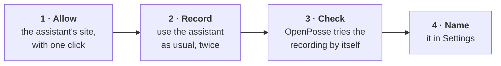
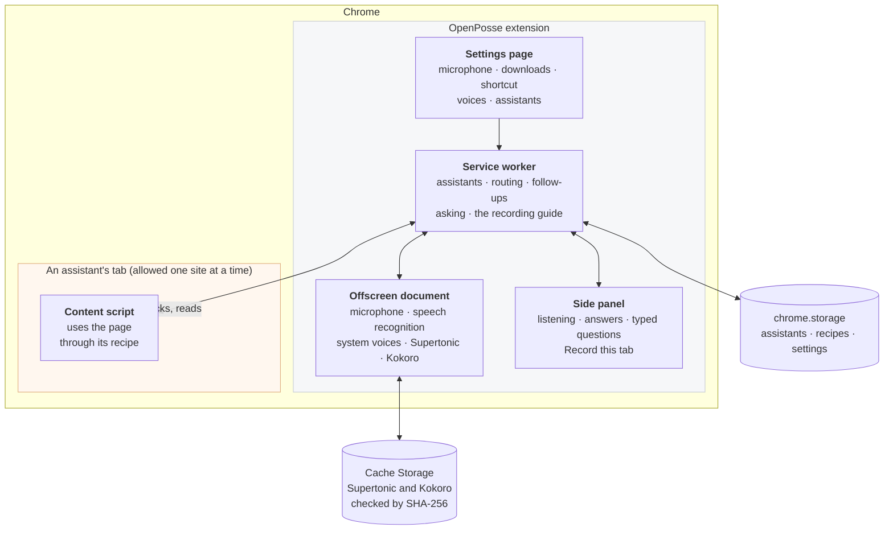
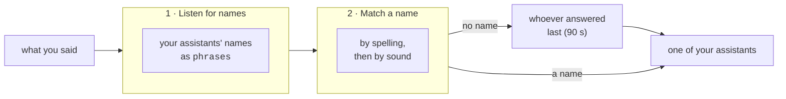
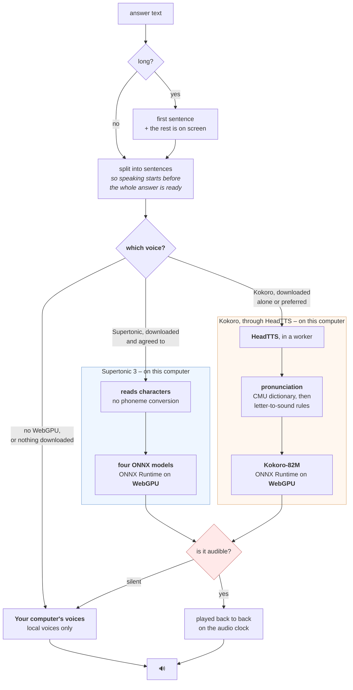

<div align="center">


**Talk to the AI assistants you already use.**

OpenPosse listens for an assistant's name, passes your question to it in the tab you already have
open, and reads the answer back to you, all on your own computer.

[](LICENSE)


</div>

---

## Overview

Many of the tools we use at work now come with an AI assistant built in. Notion has one, your
enterprise architecture tool has one, and so does your helpdesk. Each sits behind its own button,
in its own tab, with its own text box.

OpenPosse brings them together behind your voice. You give each assistant a name, and then simply
ask:

> *"Ivan, summarise the Q3 planning page."*
>
> *"Andy, how many of our applications are reaching end of life?"*
>
> *"And what about next quarter?"* – a follow-up goes to whoever answered last, so there is no need
> to repeat the name.

Press the shortcut, say a name and your question, and OpenPosse takes care of the rest. It works
out which assistant you meant, types your question into that assistant's own box, presses its send
button, waits for the reply, and reads it back to you in that assistant's voice.

Plenty of tools can dictate into a text field. OpenPosse carries the request all the way through,
which is what makes it feel more like asking a colleague than filling in a form.

### What we care about

**Your privacy.** Speech recognition, choosing the right assistant, and the voice that reads
answers back all run on your computer. There is no OpenPosse account, API key or server, and a
conversation involves only your microphone, the assistant's page and its answer.

**Simplicity.** Setting up OpenPosse never calls for a configuration file, a terminal or technical
terms. Adding an assistant is a short guided recording: you show OpenPosse how you use it once, and
it takes it from there.

**Your tabs.** OpenPosse works with the assistant in the tab you are already signed into, and when
you ask to see an answer, it brings that same tab forward. It never opens a vendor's site on your
behalf, so your conversation always stays in one place. If no tab is open for an assistant,
OpenPosse lets you know rather than opening one.

---

## Getting started

### Requirements

- **Google Chrome 139 or later**, on macOS 13 or later, Windows 10 or 11, Linux or ChromeOS. This
  is the version that brought on-device speech recognition.
- **WebGPU in Chrome**, for the neural voices. Without it, OpenPosse uses your computer's own
  voices.
- **Node.js 20 or later**, to build from source.

### Installing from source

A Chrome Web Store listing is in preparation. Until then, OpenPosse can be built and loaded
directly:

```bash
git clone https://github.com/openposse-org/openposse-extension.git && cd openposse-extension
npm install
npm run build          # a complete extension in dist/
```

Then, in Chrome:

1. Open `chrome://extensions` and turn on **Developer mode**.
2. Choose **Load unpacked** and select the `dist/` folder.
3. Settings opens. Allow the microphone, download the speech model, and choose a shortcut. If
   you close it early, OpenPosse offers to finish setup the next time you open it.
4. Open the tab with your assistant, open OpenPosse from the toolbar, and choose **Record this
   tab**.

### The keyboard shortcut

OpenPosse suggests **⌘⇧9** on a Mac and **Ctrl+Shift+9** elsewhere, because Chrome only lets an
extension suggest a shortcut from that small set. You are free to choose any combination you like
at `chrome://extensions/shortcuts`; tick **Global** there so it works while Chrome is in the
background. ⌥V is a comfortable choice. Settings shows your current shortcut and links straight to
that page.

On a Mac, ⌘⇧3 to ⌘⇧6 already belong to the screenshot tools, so those are best avoided. ChromeOS
does not support global shortcuts, so there OpenPosse is opened from the toolbar icon.

---

## Using OpenPosse

### Asking a question

Press your shortcut and OpenPosse opens in Chrome's side panel, ready to listen. Say an
assistant's name and your question. The panel shows what it heard, then the assistant's full
answer once it arrives.

Short answers are read out in full. For a longer one, OpenPosse reads the first sentence and then
asks, *"The rest is on screen. Would you like to see it?"* Answer "yes" and it brings the
assistant's tab forward; "no", or simply staying quiet, leaves you where you are.

If speaking isn't convenient, in a meeting or a quiet office for example, you can type your
question into the side panel instead. Typed questions are answered in just the same way, without
the spoken offer at the end.

### Follow-up questions

The assistant that answered last keeps the conversation for 90 seconds. During that time, a
question without a name, such as *"and what about next quarter?"*, goes straight to it.

### Seeing an answer in its tab

OpenPosse works with each assistant's page in the background, so your current tab stays in front
while you ask. That tab's title shows how the question is going: `typing…`, then `answering…`,
then `done`, until you look at the tab or for up to 90 seconds (a few seconds if you are already
looking at it), after which it reads as usual. When
you would like to see the answer where it lives, just ask:

| You say | What happens |
|---|---|
| "show me", "open it", "take me there" | Brings forward the tab of the assistant you were just talking to |
| "take me to Notion", "switch to Notion" | Brings forward that assistant's tab, by product name |
| "yes", after "Would you like to see it?" | Brings forward the tab of the assistant that just answered |
| "show me the Q3 numbers" | Treated as a question, not as navigation |

Each of these switches to a tab that is already open, the same one your question was asked in. A
phrase only counts as navigation when it makes up the whole request, so a question that happens
to begin with "show me" is always asked rather than mistaken for a request to switch tabs.

### Adding an assistant

Assistants are added by showing OpenPosse how you use them, with no code or configuration
involved. The recording takes a minute or two:



While you record, OpenPosse watches you open the assistant, type a question, send it and receive
the answer, and does so twice so that it can recognise answers in general rather than one
particular message. A short guide in the panel ticks off each step as it is captured. Once you
finish, OpenPosse replays the recording by itself to make sure it works before the assistant is
added.

The result is a **recipe**: a short description of how to use the assistant's page. Anyone adding
a shared recipe sees its steps before granting anything, along these lines:

| Step | Example |
|---|---|
| `site` | `notion.so` |
| `opens with` | `⌘ J`, or a recorded button |
| `message box` | `[data-testid="composer"] textarea` |
| `sends with` | `↩ Enter`, or a recorded button |
| `answer appears` | a container on the page |
| `knows when done` | the assistant's own "still generating" control |
| `quiet period` | `900 ms` |
| `gives up after` | `60 s` |

### Sharing an assistant

Once an assistant works for you, **Share** in Settings shows its recipe and saves it as a small
file you can send to a colleague. They add it under **Add a shared AI assistant** in Settings,
Chrome asks them to allow the assistant's site, and it is ready to use. A recipe holds the assistant's name and how to use its page, and never anything from
your conversations. The [`recipes/`](recipes) folder has an example.

### Voices

Answers can be read by three kinds of voice, chosen in Settings:

| Voice | Download | Languages | Notes |
|---|---|---|---|
| **Your computer's own voices** | none | English | Always available |
| **Supertonic** *(recommended)* | 401 MB | 31 | The fastest and most natural; its licence includes use restrictions you agree to before downloading |
| **Kokoro** | 340 MB | English | Natural and free of use restrictions |

Both downloadable voices run on your computer and need WebGPU. Once downloaded, OpenPosse uses
them automatically:

| Downloaded | Answers are read by |
|---|---|
| Supertonic | Supertonic |
| Kokoro | Kokoro |
| Both | Supertonic, or Kokoro if you prefer it under **Which one speaks** |
| Neither | your computer's own voices |

Settings also lets you set the **pace**, choose a **voice for each assistant** or let OpenPosse
choose distinct ones for you, and listen to every voice with a sample sentence of your own. With
Supertonic, you can also choose the **language** answers are read in. OpenPosse currently listens
in English only, so for other languages, type your question or try the sample.

---

## How it works

### A conversation, step by step


None of these steps uses the network. The only traffic is the assistant's own page doing what it
always does: you are signed into Notion, and Notion talks to Notion.

### Architecture



| Part | What it does | Why it lives there |
|---|---|---|
| **Offscreen document** | The microphone, speech recognition and the voices | It belongs to the extension, so the microphone is allowed once rather than once per site. It is invisible and keeps working when you switch tabs |
| **Service worker** | Your assistants, routing, follow-ups, and the recording guide | It is the one part that outlasts any single page. Chrome stops it after about 30 seconds of quiet, so it rebuilds its state from storage each time it wakes |
| **Content script** | Uses the assistant's page | Only a script inside the page can work with it |
| **Side panel** | The main window: listening, answers, typed questions and recording | It stays open while you work, sits beside any page, and can ask Chrome for access to a site |
| **Settings page** | One-time setup, downloads, voices and assistants | Chrome can only ask for the microphone from a full page |

Settings live in `chrome.storage.local`, the conversation in progress in `chrome.storage.session`
(cleared when Chrome closes), and the downloaded voices in Cache Storage, each in its own cache.

### Listening

OpenPosse uses Chrome's speech recognition with `processLocally` set, so recognition always
happens on your computer:

```js
recognition.processLocally = true;   // on-device, or not at all
recognition.interimResults = true;
recognition.phrases = roster.map(name => new SpeechRecognitionPhrase(name, 3.0));
```

- **On-device is required, not preferred.** Left at its default, Chrome may choose an online
  service. With `processLocally` set, a computer that cannot recognise speech locally reports an
  error instead, and OpenPosse tells you so.
- **Assistant names get a gentle boost.** The `phrases` weight works on a logarithmic scale, so a
  modest 3.0 is enough to help "Ivan" win over "even" without the recogniser hearing names that
  were never said.
- **Chrome decides when you have finished speaking**, so there is no timer to tune.

### Routing

Finding the right assistant happens in three simple steps, and only assistants you have added can
ever be chosen:



Matching by sound means "Andie", "Preeya" and "Macks" still reach Andy, Priya and Max. Ordinary
English words are never matched loosely, so "even" stays "even" even with an assistant called
Ivan.

Routing does not rely on Chrome's built-in language model. Many companies switch that model off
through browser policy, and OpenPosse is designed to work just as well on those computers.

### The voice



A few details that keep the voice dependable:

- **Speaking starts early.** Each sentence plays as soon as it is ready, while the next is being
  made, and sentences are scheduled on the audio clock so they join without gaps.
- **Every voice checks its own output.** If a model ever produces silence, which can happen with
  some graphics drivers, OpenPosse notices and reads the answer with a system voice instead.
- **Only local system voices are used.** Chrome lists some online voices alongside your computer's
  own, so OpenPosse picks only voices marked as local.
- **Kokoro runs at full precision (fp32).** Lighter fp16 variants are faster but produce silence
  on WebGPU today, due to a known ONNX Runtime issue
  ([#29807](https://github.com/microsoft/onnxruntime/issues/29807)).

#### Supertonic and Kokoro

[Supertonic 3](https://huggingface.co/supertone-oss-archive/supertonic-3) is the recommended voice.
It speaks 31 languages from a single download, with all ten of its voices available in every
language, and it is quick: around 0.03–0.04× real time on WebGPU in our measurements, roughly five
times faster than Kokoro. It reads text as characters, so it needs no separate pronunciation
engine.

Its model weights are published under the **BigScience Open RAIL-M** licence. The licence allows
commercial use and asks that everyone using the model agrees to a short list of use restrictions,
covering areas such as medical advice, fully automated legal decisions, and law enforcement or
immigration processes. Settings shows these restrictions in full, links to the complete licence,
and enables the download once you tick **I agree**. Your agreement is saved with the licence
version and date, and Supertonic is only ever used with it.

**Kokoro remains available for anyone who prefers a voice without those terms**, whether as a
personal choice or because an organisation's policies call for it. It is English only, and its
model and voices are Apache-2.0.

Supertonic needs WebGPU to keep up with a conversation; on computers without it, your system's
voices are used instead. Because Supertonic speaks a little faster at the same setting, its pace
is scaled so that both voices sound comfortable at the default.

#### Downloads

Each voice is downloaded once, from Settings, when you press its button, and never during a
conversation. Every file is checked against a SHA-256 fingerprint built into OpenPosse before it
is used, and any file that does not match is discarded. Both sets come from fixed versions on
Hugging Face, so the files you receive are always the ones OpenPosse was built and tested with.

### Working with real pages

Every assistant's page is built a little differently, and the recorder and content script are
designed around what real pages do:

- **Text boxes built with frameworks such as React** need text entered through the browser's
  native input path, which OpenPosse uses so the page notices what was typed.
- **Some pages ignore simulated key presses**, so OpenPosse prefers recording and clicking an
  assistant's send button over pressing Enter.
- **"Still generating" indicators** are often replaced rather than changed, so the recorder
  watches for what appears and disappears instead of watching a single element.
- **Answers arrive in stages**, so OpenPosse waits until the page has been quiet for a moment and
  any "stop" control has stayed gone before treating an answer as finished.
- **Assistants often live in frames**, so OpenPosse finds the frame that holds the assistant and
  talks to that frame directly.
- **Questions and answers can look identical** in a page's markup, so the recipe identifies the
  conversation and OpenPosse picks the answer at runtime, skipping the echo of your own question.

When a page changes in a way the recipe no longer matches, OpenPosse reports that clearly rather
than guessing, and recording the assistant again brings it up to date.

---

## Privacy and permissions

What is stored, what uses the network and what never does is described in plain language in
[PRIVACY.md](PRIVACY.md). In short, OpenPosse has no servers and sends nothing to its developers.

| Permission | Used for |
|---|---|
| `offscreen` | The microphone, speech recognition and voices |
| `storage` | Your assistants, their recipes and your settings |
| `sidePanel` | OpenPosse's main window |
| `tabs`, `scripting` | Finding an assistant's tab and working with its page |
| `activeTab`, `alarms` | Starting a recording on the current tab, and keeping OpenPosse awake while you record |
| `favicon` *(optional)* | Showing your assistants' site icons, if you turn that on |
| Site access *(optional)* | Requested **one site at a time**, when you add an assistant there |

No site access is granted when OpenPosse is installed. Chrome describes site access in broad terms
because it has only one wording for it, but OpenPosse asks for one site at a time, through a
button, and uses it only to work with the assistants you have added.

The code follows a few firm rules:

- Questions, answers and page content are never logged, stored or sent anywhere.
- Sign-ins stay in the browser. OpenPosse never reads, forwards or logs cookies, tokens or form
  values.
- Only voices that run on your computer are used.
- Nothing is downloaded during a conversation, and every download is checked before use.

---

## Development

```bash
npm test               # ESLint and the unit tests
npm run test:e2e       # the built extension in a real browser, against a sample assistant
npm run watch          # rebuild dist/ on every change; reload the extension to pick it up
npm run package        # the Chrome Web Store package
```

[docs/testing.md](docs/testing.md) describes what the automated tests cover and the checklist for
what is best checked by hand. [docs/releasing.md](docs/releasing.md) explains how a merge becomes
a beta in the Chrome Web Store and how versions are released.

### Repository layout

```
src/                     The extension's code, pages and manifest (plain JavaScript, bundled with esbuild)
  service-worker.js        routing, asking, and the recording guide
  offscreen.js             microphone, speech recognition, and the voices
  sidepanel.js             the main window
  setup.js                 Settings
  content.js               works with an assistant's page
  recorder.js              captures a recipe
  selector.js  dom.js      finding the right elements on a page
  routing.js  domain.js    choosing an assistant, and site access
  supertonic.js kokoro.js  the two downloadable voices
  player.js  tts.js        playback, and choosing which voice speaks
  supertonic/              Supertonic's browser helper, its licence, and the model's licence
  weights.js               the voice downloads: fixed versions, SHA-256 checks
public/                  Files copied as they are: icons, the pronunciation dictionary, and vendor/
recipes/                 Example assistants, as shareable recipe files
test/                    Unit tests; e2e/ browser tests, with a sample assistant in fixtures/
tools/                   The build script and developer helpers
docs/                    Testing, releasing, and design notes
dist/                    The built extension that Chrome loads (not committed)
```

OpenPosse is written in plain JavaScript without a framework, so that the whole extension stays
small enough to read and understand.

---

## Project status

**Available today:** speaking and typing to your assistants, routing by name and by sound,
follow-up questions, recording and sharing assistants, asking to see an answer in its tab, and
answers read by Supertonic, Kokoro or your computer's own voices.

**Coming next:** the Chrome Web Store listing.

**Being explored:** listening in more languages, and using an assistant's own "still generating"
indicator to read answers sooner.

---

## Licence

OpenPosse is released under the [Apache-2.0](LICENSE) licence. Bundled components and their
licences are listed in [NOTICE](NOTICE) and [public/vendor/NOTICE.md](public/vendor/NOTICE.md).

- **Kokoro-82M** and its voices are Apache-2.0, and **HeadTTS** is MIT. OpenPosse uses HeadTTS's
  own rule-based pronunciation, so no GPL-licensed component is included.
- **Supertonic**'s browser helper is MIT. Its model weights are not included in this repository
  or the extension: they are downloaded on request under the BigScience Open RAIL-M licence, whose
  full text ships with the extension as `vendor/supertonic/MODEL_LICENSE.txt`.
- **ONNX Runtime Web** is MIT, and **transformers.js** is Apache-2.0.
- The **Inter** typeface is under the SIL Open Font License 1.1.
