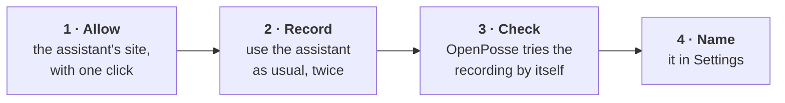
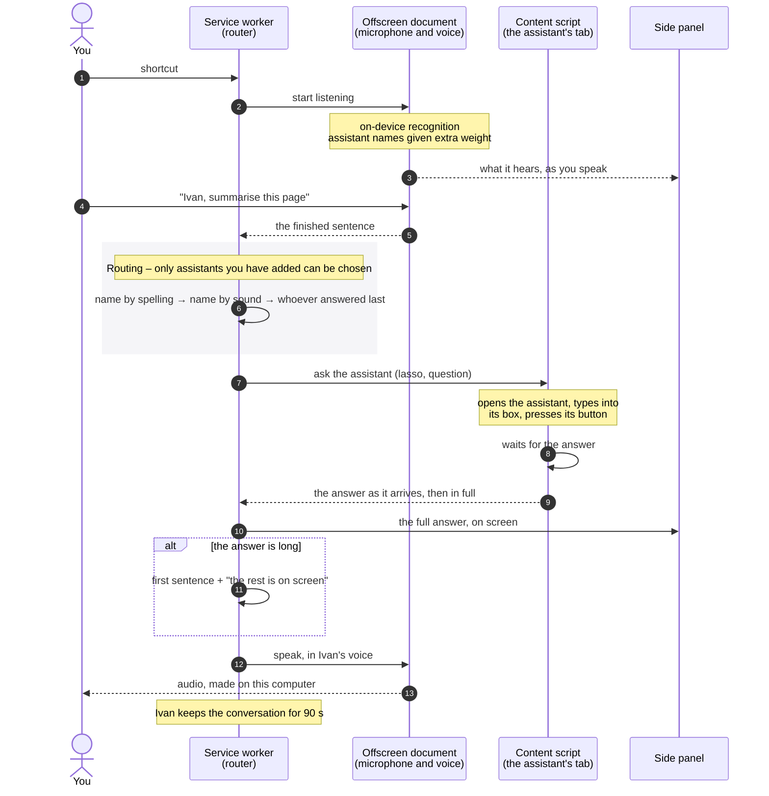
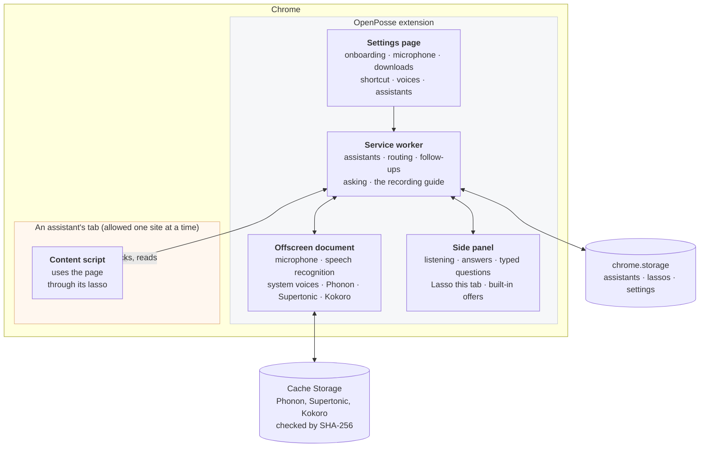
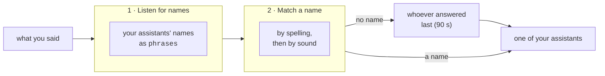
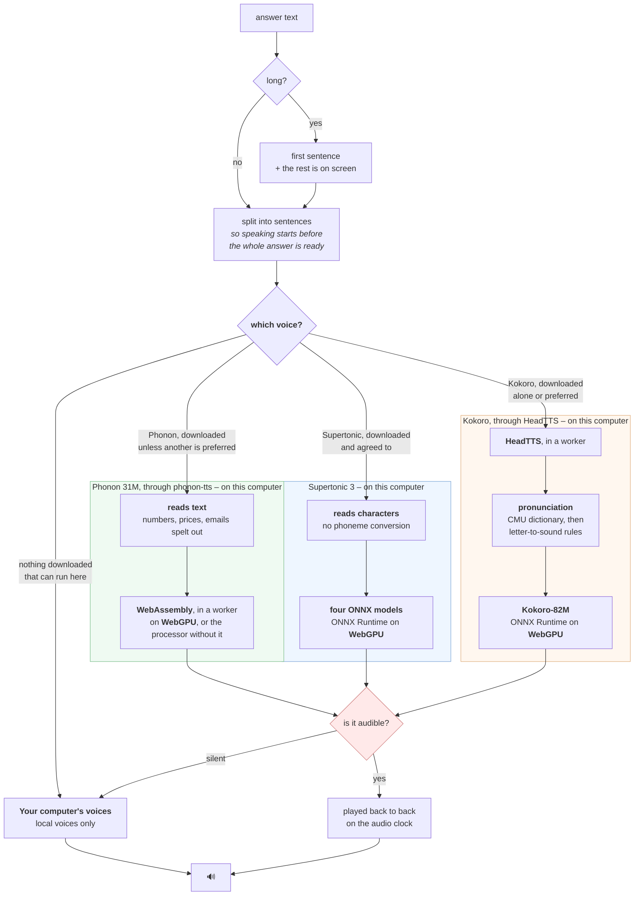

<div align="center">


**Talk to the AI assistants you already use.**

OpenPosse listens for an assistant's name, passes your question to it in the tab you already have
open, and reads the answer back to you, all on your own computer.

[](LICENSE)


</div>

---

## Overview

Many of the tools we use at work now come with an AI assistant built in. Notion has one, your
enterprise architecture tool has one, and so does your helpdesk. Each sits behind its own button,
in its own tab, with its own text box.

OpenPosse brings them together behind your voice. You give each assistant a name, and then simply
ask:

> *"Ivan, summarise the Q3 planning page."*
>
> *"Andy, how many of our applications are reaching end of life?"*
>
> *"And what about next quarter?"* – a follow-up goes to whoever answered last, so there is no need
> to repeat the name.

OpenPosse comes with five assistants already named: **Sofia** for Claude, **Sam** for ChatGPT,
**Peter** for Notion AI, **Omar** for Microsoft 365 Copilot and **Emma** for Gemini. Any other assistant can be added by showing OpenPosse how you use it.

Press the shortcut, say a name and your question, and OpenPosse takes care of the rest. It works
out which assistant you meant, types your question into that assistant's own box, presses its send
button, waits for the reply, and reads it back to you in that assistant's voice.

Plenty of tools can dictate into a text field. OpenPosse carries the request all the way through,
which is what makes it feel more like asking a colleague than filling in a form.

### What we care about

**Your privacy.** Speech recognition, choosing the right assistant, and the voice that reads
answers back all run on your computer. There is no OpenPosse account, API key or server, and a
conversation involves only your microphone, the assistant's page and its answer.

**Simplicity.** Setting up OpenPosse never calls for a configuration file, a terminal or technical
terms. The assistants that come with OpenPosse need only Chrome's Allow for their site, and adding
any other is a short guided recording: you show OpenPosse how you use it once, and it takes it
from there.

**Your tabs.** OpenPosse works with the assistant in the tab you are already signed into, and when
you ask to see an answer, it brings that same tab forward. It never opens a vendor's site on your
behalf, so your conversation always stays in one place. If no tab is open for an assistant,
OpenPosse lets you know rather than opening one.

---

## Getting started

### Requirements

- **Google Chrome 139 or later**, on macOS 13 or later, Windows 10 or 11, Linux or ChromeOS. This
  is the version that brought on-device speech recognition.
- **WebGPU in Chrome** is optional. Phonon, the default voice, runs without it, a little slower;
  Supertonic and Kokoro need it.
- **Node.js 20 or later**, to build from source.

### Installing from source

A beta is with testers in the Chrome Web Store, and the public listing is in preparation. Until
then, OpenPosse can be built and loaded directly:

```bash
git clone https://github.com/openposse-org/openposse-extension.git && cd openposse-extension
npm install
npm run build          # a complete extension in dist/
```

Then, in Chrome:

1. Open `chrome://extensions` and turn on **Developer mode**.
2. Choose **Load unpacked** and select the `dist/` folder.
3. Settings opens with a short welcome and three setup tasks, which you can move between freely:
   - **Permissions**: your shortcut, the microphone, pinning OpenPosse to the toolbar, and the
     optional [tab group](#the-tab-group).
   - **Downloads**: the speech model and a voice.
   - **Your AI assistants**: Sofia, Sam, Peter, Omar and Emma are already added, and **Allow all** lets their
     sites in with one Chrome dialog.

   If you close it early, the side panel shows **Finish setting up**, which reopens it at the
   first task with something left to do.
4. Open a tab with one of your assistants and open OpenPosse from the toolbar. For an assistant
   that does not come with OpenPosse, choose **Lasso this tab** and follow the guide.

### The keyboard shortcut

OpenPosse suggests **⌥V** on a Mac and **Ctrl+Shift+9** elsewhere. These work while Chrome is in
front: Chrome lets an extension suggest a shortcut that works from any app only if it is ⌘⇧ (or
Ctrl+Shift) and a digit, and never lets it make one global itself. To use yours with Chrome in the
background, set OpenPosse to **Global** at `chrome://extensions/shortcuts`, where you can also pick
any other keys. Settings shows your current shortcut and links straight to that page.

On a Mac, ⌘⇧3 to ⌘⇧6 already belong to the screenshot tools, so those are best avoided. ChromeOS
does not support global shortcuts, so there OpenPosse is opened from the toolbar icon.

---

## Using OpenPosse

### Asking a question

Press your shortcut and OpenPosse opens in Chrome's side panel, ready to listen. Say an
assistant's name and your question. The panel shows what it heard, then the assistant's full
answer once it arrives.

Short answers are read out in full. For a longer one, OpenPosse reads the first sentence and then
asks, *"The rest is on screen. Would you like to see it?"* Answer "yes" and it brings the
assistant's tab forward; "no", or simply staying quiet, leaves you where you are.

If speaking isn't convenient, in a meeting or a quiet office for example, you can type your
question into the side panel instead. Typed questions are answered in just the same way, without
the spoken offer at the end.

### Follow-up questions

The assistant that answered last keeps the conversation for 90 seconds. During that time, a
question without a name, such as *"and what about next quarter?"*, goes straight to it.

### Seeing an answer in its tab

OpenPosse works with each assistant's page in the background, so your current tab stays in front
while you ask. That tab's title shows how the question is going: `typing…`, then `answering…`,
then `done`, until you look at the tab or for up to 90 seconds (a few seconds if you are already
looking at it), after which it reads as usual. When
you would like to see the answer where it lives, just ask:

| You say | What happens |
|---|---|
| "show me", "open it", "take me there" | Brings forward the tab of the assistant you were just talking to |
| "take me to Notion", "switch to Notion" | Brings forward that assistant's tab, by product name |
| "yes", after "Would you like to see it?" | Brings forward the tab of the assistant that just answered |
| "show me the Q3 numbers" | Treated as a question, not as navigation |

Each of these switches to a tab that is already open, the same one your question was asked in. A
phrase only counts as navigation when it makes up the whole request, so a question that happens
to begin with "show me" is always asked rather than mistaken for a request to switch tabs.

### The tab group

If you like, OpenPosse keeps the tabs it talks to in one tab group per window, called OpenPosse.
It is off unless you switch it on, in onboarding or in Settings, and Chrome asks once for
permission to manage tab groups. A tab joins the group when you lasso it or ask it a question.
Grouping never opens or closes a tab, never moves one between windows, and leaves a tab that is
already in a group of your own where it is. Switching it off ungroups the tabs.

### Seeing what a turn looks like

The play button at the top of the side panel runs a short scripted conversation through the real
panel and the real voice, so you can see and hear how a question is routed and answered without
asking any assistant anything.

### The assistants that come with OpenPosse

OpenPosse ships with lassos for five assistants, already named:

| Assistant | Site |
|---|---|
| **Sofia** | Claude (`claude.ai`) |
| **Sam** | ChatGPT (`chatgpt.com`) |
| **Peter** | Notion AI (`notion.com`) |
| **Omar** | Microsoft 365 Copilot (`m365.cloud.microsoft`) |
| **Emma** | Gemini (`gemini.google.com`) |

A new install adds all five, each waiting for Chrome's Allow for its site, which you can give
from onboarding's last task, from **Allow all** in Settings (shown while two or more sites are
waiting), or from each assistant's row. After an update, an assistant that is new to you is
offered rather than added: on its site the side panel says OpenPosse comes with a lasso for it,
with **Add** and **Lasso it myself**. Nothing is
offered on a site where you already have an assistant. You can rename any of them in Settings.

These files are part of the extension and nothing is fetched to add them. They are the same
files as in [`lassos/`](lassos), and are added exactly as a shared file would be.

Lassos added after your version was released are on [openposse.org/lassos](https://openposse.org/lassos/).
The cloud button beside **Add a shared AI assistant** in Settings lists them, only when you press
it, and marks the sites you already have an assistant on. Picking one loads its file into the box
as if you had pasted it: you see what it does, press Add, and Chrome asks you to allow its site.
A file that does not match the list's fingerprint for it is not loaded.

### Adding an assistant

Any other assistant is added by showing OpenPosse how you use it, with no code or configuration
involved. The recording takes a minute or two:



While you record, OpenPosse watches you open the assistant, type a question, send it and receive
the answer, and does so twice so that it can recognise answers in general rather than one
particular message. A short guide in the panel ticks off each step as it is captured. Once you
finish, OpenPosse replays the recording by itself to make sure it works before the assistant is
added. If that check fails, the panel says what went wrong, and the message can be copied to send
on with a bug report.

The result is a **lasso**: a short description of how to use the assistant's page. Anyone adding
a shared lasso sees its steps before granting anything, along these lines:

| Step | Example |
|---|---|
| `site` | `notion.so` |
| `opens with` | `⌘ J`, or a recorded button |
| `message box` | `[data-testid="composer"] textarea` |
| `sends with` | `↩ Enter`, or a recorded button |
| `answer appears` | a container on the page |
| `knows when done` | the assistant's own "still generating" control |
| `quiet period` | `900 ms` |
| `gives up after` | `60 s` |

### Sharing an assistant

Once an assistant works for you, **Share** in Settings shows its lasso and saves it as a small
file you can send to a colleague. They add it under **Add a shared AI assistant** in Settings,
Chrome asks them to allow the assistant's site, and it is ready to use. A lasso holds the
assistant's name and how to use its page, and never anything from your conversations. The
[`lassos/`](lassos) folder has examples, including the ones that come with OpenPosse.

Each site has one assistant. Each file says when its lasso was recorded, and adding one for a
site that already has an assistant offers to replace that assistant's lasso, keeping its name,
voice and colour; adding the same one again simply says you have it. Recording a site that already
has an assistant re-records it in the same way.

### Voices

Answers can be read by four kinds of voice, chosen in Settings:

| Voice | Download | Languages | Notes |
|---|---|---|---|
| **Your computer's own voices** | none | English | Always available |
| **Phonon** *(recommended)* | 66 MB | English | Fast and natural, free of use restrictions, and works without WebGPU |
| **Supertonic** | 401 MB | 31 | Fast and natural; its licence includes use restrictions you agree to before downloading; needs WebGPU |
| **Kokoro** | 340 MB | English | Natural and free of use restrictions; needs WebGPU |

All three downloadable voices run on your computer. Once downloaded, OpenPosse uses them
automatically:

| Downloaded | Answers are read by |
|---|---|
| Phonon, with or without the others | Phonon, or another you choose under **Which one speaks** |
| Supertonic and Kokoro | Supertonic, or Kokoro if you prefer it |
| Only Supertonic, or only Kokoro | that one |
| None | your computer's own voices |

Settings also lets you set the **pace**, choose a **voice for each assistant** or let OpenPosse
choose distinct ones for you, and listen to every voice with a sample sentence of your own. With
Supertonic, you can also choose the **language** answers are read in. OpenPosse currently listens
in English only, so for other languages, type your question or try the sample.

---

## How it works

### A conversation, step by step



None of these steps uses the network. The only traffic is the assistant's own page doing what it
always does: you are signed into Notion, and Notion talks to Notion.

### Architecture



| Part | What it does | Why it lives there |
|---|---|---|
| **Offscreen document** | The microphone, speech recognition and the voices | It belongs to the extension, so the microphone is allowed once rather than once per site. It is invisible and keeps working when you switch tabs |
| **Service worker** | Your assistants, routing, follow-ups, and the recording guide | It is the one part that outlasts any single page. Chrome stops it after about 30 seconds of quiet, so it rebuilds its state from storage each time it wakes |
| **Content script** | Uses the assistant's page | Only a script inside the page can work with it |
| **Side panel** | The main window: listening, answers, typed questions and recording | It stays open while you work, sits beside any page, and can ask Chrome for access to a site |
| **Settings page** | One-time setup, downloads, voices and assistants | Chrome can only ask for the microphone from a full page |

Settings live in `chrome.storage.local`, the conversation in progress in `chrome.storage.session`
(cleared when Chrome closes), and the downloaded voices in Cache Storage, each in its own cache.

### Listening

OpenPosse uses Chrome's speech recognition with `processLocally` set, so recognition always
happens on your computer:

```js
recognition.processLocally = true;   // on-device, or not at all
recognition.interimResults = true;
recognition.phrases = roster.map(name => new SpeechRecognitionPhrase(name, 3.0));
```

- **On-device is required, not preferred.** Left at its default, Chrome may choose an online
  service. With `processLocally` set, a computer that cannot recognise speech locally reports an
  error instead, and OpenPosse tells you so.
- **Assistant names get a gentle boost.** The `phrases` weight works on a logarithmic scale, so a
  modest 3.0 is enough to help "Ivan" win over "even" without the recogniser hearing names that
  were never said.
- **Chrome decides when you have finished speaking**, so there is no timer to tune.

### Routing

Finding the right assistant happens in three simple steps, and only assistants you have added can
ever be chosen:



Matching by sound means "Andie", "Preeya" and "Macks" still reach Andy, Priya and Max. Ordinary
English words are never matched loosely, so "even" stays "even" even with an assistant called
Ivan.

Routing does not rely on Chrome's built-in language model. Many companies switch that model off
through browser policy, and OpenPosse is designed to work just as well on those computers.

### The voice



A few details that keep the voice dependable:

- **Speaking starts early.** Each sentence plays as soon as it is ready, while the next is being
  made, and sentences are scheduled on the audio clock so they join without gaps.
- **Every voice checks its own output.** If a model ever produces silence, which can happen with
  some graphics drivers, OpenPosse notices and reads the answer with a system voice instead.
- **Only local system voices are used.** Chrome lists some online voices alongside your computer's
  own, so OpenPosse picks only voices marked as local.
- **Kokoro runs at full precision (fp32).** Lighter fp16 variants are faster but produce silence
  on WebGPU today, due to a known ONNX Runtime issue
  ([#29807](https://github.com/microsoft/onnxruntime/issues/29807)).

#### Phonon

[Phonon 31M](https://huggingface.co/gradium/phonon-31m-en) is the recommended voice. It is English
only, its model, tokenizer and voices are Apache-2.0, and at 66 MB it is a fifth of the size of
the others. It runs through [phonon-tts](https://www.npmjs.com/package/phonon-tts), which ships
with the extension: on WebGPU it measured 0.04–0.05× real time, as fast as Supertonic, and on the
computer's processor alone 0.15×, so it is the one neural voice that does not need WebGPU. It
reads numbers, prices, dates and email addresses out properly on its own, and needs no separate
pronunciation engine. Four of its voices ship, two American and two British.

Only the 31M English model is used. Phonon's larger 40M models are under a non-commercial licence
and are not offered.

#### Supertonic and Kokoro

[Supertonic 3](https://huggingface.co/supertone-oss-archive/supertonic-3) is the voice for other
languages. It speaks 31 languages from a single download, with all ten of its voices available in every
language, and it is quick: around 0.03–0.04× real time on WebGPU in our measurements, roughly five
times faster than Kokoro. It reads text as characters, so it needs no separate pronunciation
engine.

Its model weights are published under the **BigScience Open RAIL-M** licence. The licence allows
commercial use and asks that everyone using the model agrees to a short list of use restrictions,
covering areas such as medical advice, fully automated legal decisions, and law enforcement or
immigration processes. Settings shows these restrictions in full, links to the complete licence,
and enables the download once you tick **I agree**. Your agreement is saved with the licence
version and date, and Supertonic is only ever used with it.

**Kokoro remains available for anyone who prefers a voice without those terms**, whether as a
personal choice or because an organisation's policies call for it. It is English only, and its
model and voices are Apache-2.0.

Supertonic needs WebGPU to keep up with a conversation; on computers without it, your system's
voices are used instead. Because Supertonic speaks a little faster at the same setting, its pace
is scaled so that both voices sound comfortable at the default.

#### Downloads

Each voice is downloaded once, from Settings, when you press its button, and never during a
conversation. Every file is checked against a SHA-256 fingerprint built into OpenPosse before it
is used, and any file that does not match is discarded. Both sets come from fixed versions on
Hugging Face, so the files you receive are always the ones OpenPosse was built and tested with.

### Working with real pages

Every assistant's page is built a little differently, and the recorder and content script are
designed around what real pages do:

- **Text boxes built with frameworks such as React** need text entered through the browser's
  native input path, which OpenPosse uses so the page notices what was typed.
- **Some pages ignore simulated key presses**, so OpenPosse prefers recording and clicking an
  assistant's send button over pressing Enter.
- **"Still generating" indicators** are often replaced rather than changed, so the recorder
  watches for what appears and disappears instead of watching a single element.
- **Answers arrive in stages**, so OpenPosse waits until the page has been quiet for a moment and
  any "stop" control has stayed gone before treating an answer as finished.
- **Assistants often live in frames**, so OpenPosse finds the frame that holds the assistant and
  talks to that frame directly.
- **Questions and answers can look identical** in a page's markup, so the lasso identifies the
  conversation and OpenPosse picks the answer at runtime, skipping the echo of your own question.

When a page changes in a way the lasso no longer matches, OpenPosse reports that clearly rather
than guessing, and recording the assistant again brings it up to date.

---

## Privacy and permissions

What is stored, what uses the network and what never does is described in plain language in
[PRIVACY.md](PRIVACY.md). In short, OpenPosse has no servers and sends nothing to its developers.

| Permission | Used for |
|---|---|
| `offscreen` | The microphone, speech recognition and voices |
| `storage` | Your assistants, their lassos and your settings |
| `sidePanel` | OpenPosse's main window |
| `tabs`, `scripting` | Finding an assistant's tab and working with its page |
| `activeTab` | Starting a recording on the current tab |
| `favicon` *(optional)* | Showing your assistants' site icons, if you turn that on |
| `tabGroups` *(optional)* | Keeping the tabs OpenPosse talks to in one tab group, if you turn that on |
| Site access *(optional)* | Requested **one site at a time**, when you add an assistant there |

No site access is granted when OpenPosse is installed. Chrome describes site access in broad terms
because it has only one wording for it, but OpenPosse asks for one site at a time, through a
button, and uses it only to work with the assistants you have added.

The code follows a few firm rules:

- Questions, answers and page content are never logged, stored or sent anywhere.
- Sign-ins stay in the browser. OpenPosse never reads, forwards or logs cookies, tokens or form
  values.
- Only voices that run on your computer are used.
- Nothing is downloaded during a conversation, and every download is checked before use.

---

## Development

```bash
npm test               # ESLint and the unit tests
npm run test:e2e       # the built extension in a real browser, against a sample assistant
npm run watch          # rebuild dist/ on every change; reload the extension to pick it up
npm run package        # the Chrome Web Store package
```

[docs/testing.md](docs/testing.md) describes what the automated tests cover and the checklist for
what is best checked by hand. [docs/releasing.md](docs/releasing.md) explains how a merge becomes
a beta in the Chrome Web Store and how versions are released.

### Repository layout

```
src/                     The extension's code, pages and manifest (plain JavaScript, bundled with esbuild)
  service-worker.js        routing, asking, and the recording guide
  offscreen.js             microphone, speech recognition, and the voices
  sidepanel.js             the main window
  setup.js                 Settings
  onboarding.js  steps.js  the first-run tasks over Settings, read fresh from Chrome each time
  builtin.js               the lassos that come with OpenPosse, and offering them on their sites
  grouping.js              the optional OpenPosse tab group
  demo.js                  the scripted turn behind the side panel's play button
  content.js               works with an assistant's page
  recorder.js              captures a lasso
  selector.js  dom.js      finding the right elements on a page
  routing.js  domain.js    choosing an assistant, and site access
  phonon.js supertonic.js kokoro.js  the three downloadable voices
  player.js  tts.js        playback, and choosing which voice speaks
  supertonic/              Supertonic's browser helper, its licence, and the model's licence
  weights.js               the voice downloads: fixed versions, SHA-256 checks
  catalog.js               the lassos list on openposse.org, read from Settings' cloud button
public/                  Files copied as they are: icons, the pronunciation dictionary, and vendor/
lassos/                  The assistants that ship with OpenPosse, plus the website's demo one, as shareable lasso files
test/                    Unit tests; e2e/ browser tests, with a sample assistant in fixtures/
tools/                   The build script and developer helpers
docs/                    Testing, releasing, and design notes
dist/                    The built extension that Chrome loads (not committed)
```

OpenPosse is written in plain JavaScript without a framework, so that the whole extension stays
small enough to read and understand.

---

## Project status

**Available today:** speaking and typing to your assistants, routing by name and by sound,
follow-up questions, Sofia, Sam, Peter, Omar and Emma for Claude, ChatGPT, Notion AI, Copilot and Gemini out of
the box,
recording and sharing other assistants, guided first-run setup, an optional tab group, asking to
see an answer in its tab, and answers read by Phonon, Supertonic, Kokoro or your computer's own
voices.

**Coming next:** the public Chrome Web Store listing (a beta is with testers now).

**Being explored:** listening in more languages, and using an assistant's own "still generating"
indicator to read answers sooner.

---

## Licence

OpenPosse is released under the [Apache-2.0](LICENSE) licence. Bundled components and their
licences are listed in [NOTICE](NOTICE) and [public/vendor/NOTICE.md](public/vendor/NOTICE.md).

- **Kokoro-82M** and its voices are Apache-2.0, and **HeadTTS** is MIT. OpenPosse uses HeadTTS's
  own rule-based pronunciation, so no GPL-licensed component is included.
- **Phonon 31M**'s model and voices are Apache-2.0, and **phonon-tts**, which runs it and ships in
  `public/vendor/phonon/`, is MIT or Apache-2.0; the Rust crates compiled into its WebAssembly are
  MIT, ISC, zlib and Unicode-3.0.
- **Supertonic**'s browser helper is MIT. Its model weights are not included in this repository
  or the extension: they are downloaded on request under the BigScience Open RAIL-M licence, whose
  full text ships with the extension as `vendor/supertonic/MODEL_LICENSE.txt`.
- **ONNX Runtime Web** is MIT, and **transformers.js** is Apache-2.0.
- The **Inter** typeface is under the SIL Open Font License 1.1.
